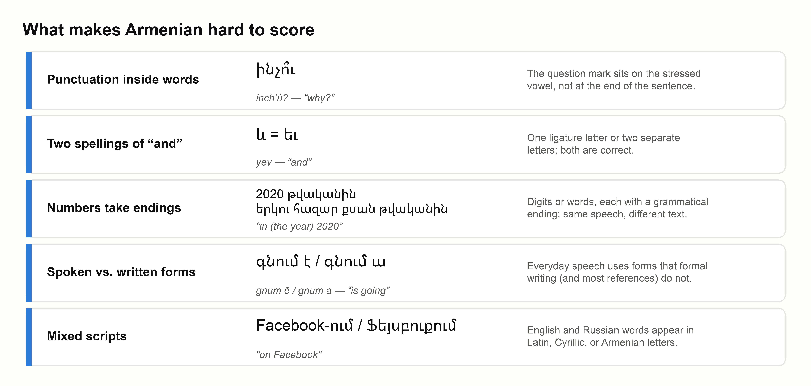
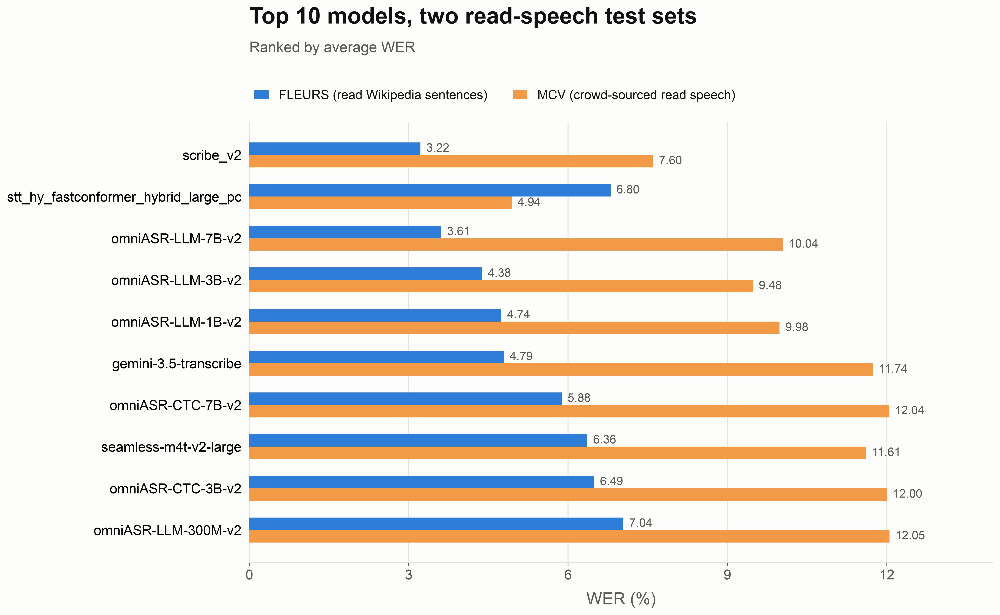

# Armenian Joins the Open ASR Leaderboard

*Metric AI Lab and Hugging Face add Armenian 🇦🇲 to the Multilingual tab of the Open ASR Leaderboard*

We have added Armenian to the [Open ASR Leaderboard](https://huggingface.co/spaces/hf-audio/open_asr_leaderboard). This release brings:

1. **Armenian in the 🌍 Multilingual tab**, next to the other languages on the leaderboard, with results for 17 open and closed models.
2. **Two public test sets**, FLEURS (with corrected references) and Common Voice 26, in the leaderboard's [evaluation format](https://huggingface.co/datasets/Metric-AI/open-asr-leaderboard-multilingual-datasets).
3. **Armenian-specific normalization**, so that the reported WER reflects differences in what models transcribed, rather than differences in how they format text.

Adding a language to a leaderboard sounds like uploading a test set and running the models. For Armenian, most of the work went into a narrower question: when a transcript doesn't match the reference, is the model actually wrong? Often it isn't. This post covers how we handled that, what the first results show, and what the scores still can't tell you.

## When a correct transcript counts as an error

Armenian doesn't put its question mark at the end of the sentence. It goes on the stressed vowel, inside the word. A model that hears a question correctly but writes an ASCII `?` at the end produces a different word from the reference, and plain WER counts it as an error.

Armenian has several cases like this:

  

Generic multilingual normalization handles almost none of these, so we wrote one for Armenian. It runs on both the reference and the prediction before scoring. It removes punctuation and capitalization, treats the two spellings of "and" as the same word, and rewrites numbers, years, percentages and clock times into one form, whether they were written as digits or as words. Latin and Cyrillic words are kept as they are rather than deleted.

Two cases are deliberately left alone. Colloquial verb forms are not mapped to their literary equivalents, and a name written in Latin letters is not matched to its Armenian spelling. A rule can't reliably tell these apart from real mistakes, so they still count as errors, in the same way for every model.

## Two test sets, two rankings

Both sets are mostly Eastern Armenian read speech, but they were collected in different ways:

| Dataset | Clips | Duration | Style | Notes |
|:--|--:|--:|:--|:--|
| [FLEURS](https://huggingface.co/datasets/Metric-AI/open-asr-leaderboard-multilingual-datasets/viewer/fleurs_hy) | 932 | 3.0 h | Read Wikipedia sentences | All references [manually checked and corrected](https://huggingface.co/datasets/Metric-AI/fleurs-corrections) |
| [Common Voice 26](https://huggingface.co/datasets/Metric-AI/open-asr-leaderboard-multilingual-datasets/viewer/mcv_hy) | 6,892 | 10.8 h | Crowd-sourced read speech | Short clips, many volunteer speakers and microphones |

Every model runs with the same settings on both sets and is scored with the same normalizer, so differences between the two columns come from the data, not the evaluation setup.

  

The ranking depends on which set you look at. NVIDIA's [Armenian FastConformer](https://huggingface.co/nvidia/stt_hy_fastconformer_hybrid_large_pc), a small model trained only for Armenian, is 9th on FLEURS and 1st on Common Voice. It is also the only one that does better on Common Voice. Meta's omniASR-LLM-7B goes the other way: 2nd on FLEURS, 5th on Common Voice.

The sets differ in speakers, microphones, content and clip length, so we can't attribute the gap to one cause. What it does show is that a ranking built on either set alone would be misleading, which is why the leaderboard reports both.

## What read speech doesn't show

Both public sets are read speech, and read speech is the easy case. In [ArmBench-ASR](https://metric-ai-armbench-asr.static.hf.space/index.html), the median model's normalized WER on dialogue from Armenian films was about 38.8%, against about 11.3% on Common Voice.

So, we plan to add three private test sets to the leaderboard: dialogue from **movies**, often over music and background noise; **news** narration; and recited **poems**, often with background music. Like the leaderboard's other private sets, they will be held out to limit overfitting to the benchmark, and the Hugging Face team will run the evaluation. FLEURS and Common Voice stay as the baseline anyone can reproduce.

## What the score still misses

The normalizer makes WER fair across formatting, but not across every legitimate way of writing the same speech. A colloquial verb form transcribed as literary, a foreign name in Armenian letters instead of Latin, a word with two accepted spellings: all of these still count as errors. That keeps the metric deterministic and reproducible, at the cost of some noise. In ArmBench-ASR, Metric AI Lab is testing complementary approaches, including LLM-assisted scoring, that can tell these cases apart.

## How to use it

On the [Open ASR Leaderboard](https://huggingface.co/spaces/hf-audio/open_asr_leaderboard), open the **🌍 Multilingual** tab. Armenian is not selected by default, so check "Armenian" under "Languages", or choose it from the **Language dataset breakdown** dropdown to see each test set separately.

## What comes next

- **Private datasets**: Adding the Movies, News, and Poems datasets.
- **Code-switching:** Including speech where speakers naturally alternate between Armenian and other commonly used languages, particularly English and Russian.
- **More diverse conversations:** Expanding the dataset to include informal discussions, interviews, customer-service calls, meetings, podcasts, and conversations with multiple speakers, including interruptions and overlapping speech.
- **Specialized domains:** Adding speech from fields such as healthcare, law, finance, education, technology, and government, where technical vocabulary and proper names can make transcription more difficult.
- **Speaker diarization:** Assessing whether systems can correctly identify who is speaking and when, especially in recordings with multiple or overlapping speakers.
- **Additional transcription tasks:** Evaluating both verbatim and cleaned-up transcripts, including punctuation, capitalization, removal of disfluencies, and conversion of spoken language into readable text.
- **Timestamp and segmentation accuracy:** Evaluating how accurately systems assign timestamps to words and utterances, divide longer recordings into segments, and handle pauses and speaker transitions.

Together, these additions would make the benchmark better reflect real-world speech recognition applications, where performance depends on more than achieving a low word error rate (WER) on short, single-speaker recordings.